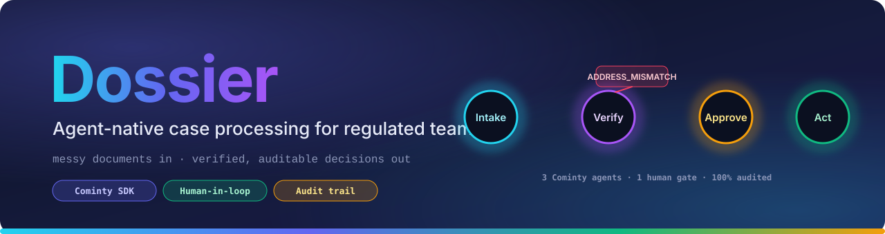
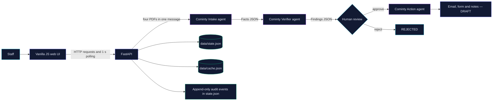

<p align="center">
  
</p>

<p align="center">
  <a href="<DEMO_URL>"></a>
  <a href="<VIDEO_URL>"></a>
  <a href="https://github.com/<YOUR_GITHUB>"></a>
  
  
</p>

<p align="center"><b>Document intake, verification, human review, and draft generation — with synthetic data only.</b></p>

<p align="center">
  
</p>

> [!CAUTION]
> **Synthetic data only. Nothing is submitted.** Dossier produces draft artifacts for staff review. The CAF is mocked; there is no CAF connection or submission.

## What it does

Dossier is a small FastAPI application for processing a selected synthetic dossier. Four PDFs (lease, RIB, enrollment certificate, and permit) are sent together to the Cominty Intake agent. The resulting structured facts go to the Verifier agent as text. A staff member then approves or rejects the findings in the web UI. Only after approval does the Action agent produce an email, form, and staff notes as drafts.

The application backend enforces approval. It does not submit forms or send email.

## Architecture



### Pipeline states

`CREATED → INTAKE_RUNNING → VERIFY_RUNNING → AWAITING_APPROVAL → ACTION_RUNNING → DONE`

The reviewer may instead reject a dossier at `AWAITING_APPROVAL`, which moves it to `REJECTED` and prevents the Action agent from running. Errors move an active pipeline to `FAILED`.

## Governance and reliability

- **Approval is backend-enforced.** The approve endpoint accepts a request only in `AWAITING_APPROVAL`; it rejects repeat approval and approval of other states. Findings with errors do not prevent an approved Action run—the generated email should request a corrected document.
- **Audit trail.** Timestamped transitions, agent call hashes and latency, validation failures, retries, cache hits, and approval/rejection events are appended to `data/state.json`. State is stored in JSON files, not SQLite.
- **Run cap.** `DOSSIER_MAX_RUNS` caps counted Cominty `chat.start` and `chat.send` calls. A request that cannot be accommodated is rejected with HTTP 429 before an agent call.
- **Result cache.** `data/cache.json` caches replies by agent ID, prompt version, message, and sorted content hashes of attached files. Cache hits do not consume runs.
- **Agent setup.** Each agent uses one model configured in the Cominty dashboard; this code has no small/strong model variants. The current pipeline does not use a Skill or Cominty memory namespaces.
- **Cominty agent capabilities.** In the Cominty dashboard, disable web search, integrations, skills, generation, and subagents for each agent.
- **No automatic submission.** Generated artifacts are labelled drafts; the CAF is mocked.

### Reliability evaluation

Results recorded in [`data/eval/latest.json`](data/eval/latest.json), measured on **2 synthetic cases**. This is a small evaluation and is **indicative only**.

| Variant | Field accuracy | Planted-error recall | False positives | Runs | Average latency | Cost per dossier |
|---|---:|---:|---:|---:|---:|---|
| default | 100% | 100% | 0 | 2 | 11.89 s | n/a (not exposed by the SDK; see Cominty usage dashboard) |

Both cases reached `AWAITING_APPROVAL`. The planted `ADDRESS_MISMATCH` was detected in `case_a`; `case_c` returned no findings, including no name mismatch for the accented/unaccented name variation.

## Quickstart

Requirements: Python 3.12 and a Cominty account with the three configured agents. Agent capabilities must be restricted in the Cominty dashboard as described above.

```bash
git clone https://github.com/<YOUR_GITHUB>
cd dossier
python3.12 -m venv .venv
source .venv/bin/activate
pip install -r requirements.txt
cp .env.example .env
# Edit .env with your Cominty credentials and agent IDs.
uvicorn app.main:app --port 8000
```

Open [http://localhost:8000](http://localhost:8000). Run the offline test suite with:

```bash
pytest -q
```

The evaluation script calls Cominty agents and consumes runs. Run it only when you intend to execute the agent pipeline:

```bash
python scripts/eval.py
```

It reads the synthetic ground truth and writes `data/eval/latest.json`. Repeated identical calls may use the result cache.

## Configuration

Copy `.env.example` to `.env`. The application loads it at startup. The first five variables are required; the others have defaults.

| Variable | Required | Default | Purpose |
|---|:---:|---|---|
| `COMINTY_API_KEY` | Yes | — | Cominty API credential |
| `COMINTY_USER_ID` | Yes | — | Cominty user ID |
| `AGENT_ID_INTAKE` | Yes | — | Intake agent ID |
| `AGENT_ID_VERIFIER` | Yes | — | Verifier agent ID |
| `AGENT_ID_ACTION` | Yes | — | Action agent ID |
| `DOSSIER_MAX_RUNS` | No | `40` | Maximum counted `chat.start` / `chat.send` calls |
| `PROMPT_VERSION` | No | `v1` | Included in result-cache keys |

Startup fails with a message naming missing required variables. Never commit `.env` or real credentials.

## HTTP API

Errors use a JSON object such as `{"error":"human readable message"}`.

| Method | Path | Purpose |
|---|---|---|
| `GET` | `/` | Serve the web UI |
| `GET` | `/healthz` | Liveness response |
| `GET` | `/api/demo-cases` | List case IDs under `data/synthetic/cases` |
| `POST` | `/api/cases` | Create a case and start Intake and Verify in a background task; body: `{"demo_case_id":"case_a"}` |
| `GET` | `/api/cases/{id}` | Return case state, facts, findings, artifacts, run count, and error |
| `POST` | `/api/cases/{id}/approve` | Start Action only for a reviewed case in `AWAITING_APPROVAL`; body: `{"reviewed":true}` |
| `POST` | `/api/cases/{id}/reject` | Reject a case awaiting approval; Action does not run |
| `GET` | `/api/audit` | Return audit events and run-cap/cache-hit summary |
| `GET` | `/api/eval/latest` | Return the latest evaluation JSON or `{"status":"idle"}` |

## Project structure

```text
.
├── app/
│   ├── gateway.py          # Sole Cominty SDK integration
│   ├── main.py             # FastAPI app, lifespan, HTTP routes
│   ├── models.py           # Pydantic contracts and reply parser
│   └── pipeline.py         # State machine, cache, budget, audit, pipeline
├── data/
│   ├── eval/latest.json    # Latest synthetic evaluation, when available
│   ├── state.json          # Runtime cases and append-only audit log
│   ├── cache.json          # Cached agent replies
│   └── synthetic/
│       ├── cases/          # Four PDFs per demo case
│       └── ground_truth/   # Evaluation labels
├── docs/assets/            # README banner and divider images
├── scripts/eval.py         # Agent-backed evaluation runner
├── tests/test_dossier.py   # Offline parser and fake-gateway tests
├── web/                    # Vanilla HTML, CSS and JavaScript UI
├── .env.example
└── requirements.txt
```

## Builder's notes

1. The Cominty website shows `run.approve()` / `resume()`, but introspection found no such methods on the run or reply objects. Approval is therefore enforced by the Dossier application backend.
2. No token or cost data is exposed on Cominty events or replies. Usage is not reported by the application; cost per dossier is not available from the SDK and must be checked in the Cominty usage dashboard.
3. JSON-only output required an explicit prompt instruction because agents sometimes added prose before the JSON. The app extracts JSON from a fenced block or from the first `{` through the last `}` and validates it.

## Roadmap

- Compare model configurations or variants.
- Package agent instructions as a Cominty Skill.
- Reuse Cominty memory namespaces across dossiers.
- Adopt a native Cominty approval flow if a supported API becomes available.
- Replace one-second UI polling with server-sent events (SSE).

<p align="center">
  
</p>

<p align="center"><sub>Built for a reviewable workflow. Synthetic data only; the evaluation is small and indicative.</sub></p>
